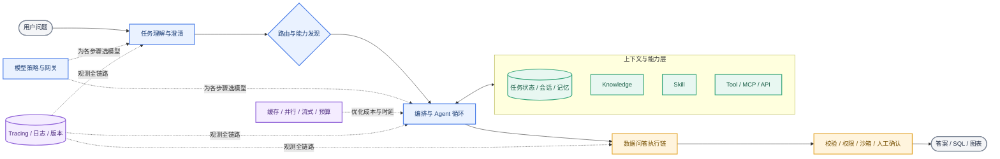
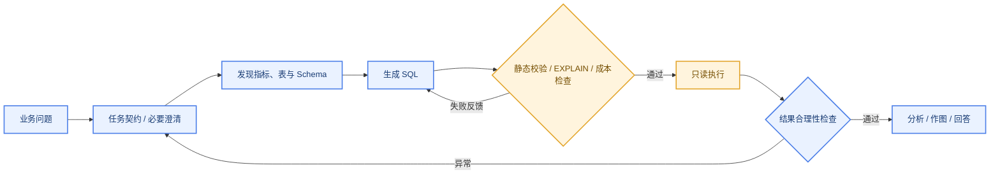
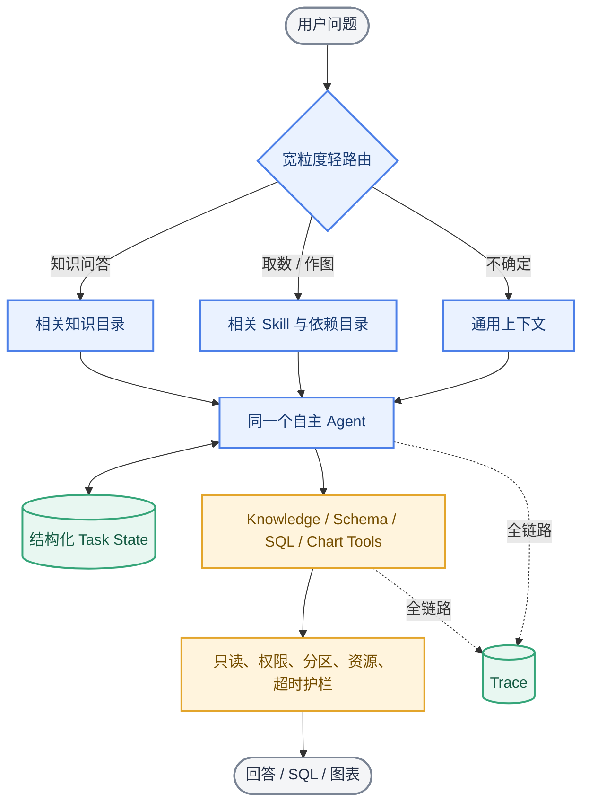

# AI 调研报告（二）：企业数据问答 AI 架构全景

调研日期：2026-10-19

> 本文先完整介绍行业中的主要架构方向，再单独给出适配当前公司的建议。前半部分不因“目前是否适合实施”而删减方案。本文聚焦架构；知识库内容治理见第一部分，评价指标体系留待第三部分。

## 1. 一张图看懂完整架构

企业问答 AI 不只是“模型 + 知识库”。一个较完整的系统通常包含十类能力：



准确率、成本和响应速度通常不是靠某一个组件解决：路由减少无关上下文，状态防止遗忘，Tool 把确定性动作交给代码，SQL 护栏减少错误执行，模型路由和缓存控制成本，可观测性帮助定位究竟是哪一环失败。

---

## 2. 整体系统有哪几种形态

这些是“整个问答系统如何工作”的顶层形态。企业通常不是六选一，而是按任务混合使用。

| 形态 | 核心做法 | 优势 | 主要局限 | 代表依据 |
|---|---|---|---|---|
| 直接模型调用 | 一次 Prompt 得到一次回答，可配结构化输出 | 最快、最便宜、最易维护 | 无法自主查资料或执行动作 | OpenAI 将直接 Responses API 与完整 Agent runtime 区分。[OpenAI 官方文档](https://developers.openai.com/api/docs/guides/agents) |
| 固定 RAG / 固定流水线 | 查询改写 → 检索 → 拼上下文 → 生成 | 稳定、时延可控、易排查 | 多来源、多跳问题适应性弱 | [Microsoft：Standard RAG 与 Agentic RAG 对比](https://learn.microsoft.com/en-us/azure/architecture/ai-ml/guide/rag/rag-agentic) |
| 单 Agent + Tools | 一个模型在 ReAct 循环中自主选工具、观察结果并继续 | 灵活，适合大量长尾任务；上下文交接少 | 易绕路、遗忘、死循环；成本与时延波动 | Anthropic 建议先从简单、可组合的单 Agent 设计开始。[Building Effective Agents](https://www.anthropic.com/engineering/building-effective-agents) |
| 代码化 Workflow | 步骤、分支和停止条件由代码或图预定义 | 可预测、可审计，稳定任务表现好 | 流程设计错误会限制模型；维护成本高 | Microsoft 列出 Sequential、Concurrent、Handoff、Group Chat、Magentic 等编排。[官方文档](https://learn.microsoft.com/agent-framework/workflows/orchestrations/) |
| 混合式 / 有限自主 | 外层固定阶段和安全边界，阶段内由 Agent 自主决策 | 在灵活性、稳定性之间折中 | 要明确哪些决策交给模型、哪些交给代码 | Anthropic 区分预定义 Workflow 与动态 Agent，并主张按复杂度渐进增加。[官方文章](https://www.anthropic.com/engineering/building-effective-agents) |
| 多 Agent | Router、Supervisor 或协调者把子任务交给专门 Agent | 专业上下文隔离，可并行，可分权限 | 调用次数、协调损耗、调试难度通常最高 | OpenAI 区分 Handoff 与“Agent as Tool”；Google 数据科学参考架构使用数据库和分析专门 Agent。[OpenAI](https://developers.openai.com/api/docs/guides/agents/orchestration) · [Google](https://docs.cloud.google.com/architecture/agentic-ai-data-science) |

一个重要行业共识是：架构复杂度应该由任务复杂度证明，而不是以“是否用了多 Agent”判断先进性。OpenAI 官方建议只有在能力、策略或上下文确实需要隔离时才增加 Specialist；过早拆分会带来更多 Prompt、Trace 和审批面。[OpenAI 官方文档](https://developers.openai.com/api/docs/guides/agents/orchestration)

---

## 3. 十个需要考虑的架构方面

### 3.1 任务理解、澄清与任务契约

| 方法 | 说明 | 优势 | 局限 |
|---|---|---|---|
| 只依赖聊天历史 | 模型从原始对话中自己找目标和条件 | 零额外开发，最灵活 | 长对话中容易丢条件、目标和已完成动作 |
| 问题改写 | 把“那上海呢”等追问改写为自包含问题 | 提升检索和路由稳定性 | 改写可能错误继承上下文 |
| 主动澄清 | 缺时间、范围、指标等关键条件时追问 | 防止带着错误假设执行 | 增加一轮时延，过度追问影响体验 |
| 结构化任务契约 | 把目标、指标、维度、过滤条件、交付物写入 JSON/YAML 状态 | 条件显式、可验证、后续步骤共享 | 需要定义字段以及更新规则 |

Microsoft 的对话式 RAG 指南建议保留近期历史、总结更早历史，并在检索前把当前问题改写为自包含查询。[Microsoft 官方文档](https://learn.microsoft.com/en-us/azure/architecture/ai-ml/guide/rag/rag-prompt-engineering)

### 3.2 路由与专业化

| 方法 | 如何路由 | 优势 | 局限与风险 |
|---|---|---|---|
| 显式入口 | 用户选择“知识问答 / 取数 / 作图” | 准确、零模型成本 | 用户要理解系统分类 |
| 规则路由 | 关键词、文件类型、命令或正则 | 快、便宜、可解释 | 难覆盖自然语言长尾 |
| 小模型分类 | 单独模型输出任务标签和置信度 | 覆盖模糊表达，成本较低 | 多一次调用；分类错误会级联 |
| 主模型自主路由 | 主 Agent 根据描述选择 Skill、Tool 或子 Agent | 灵活、少一层系统 | 工具太多或描述重叠时容易误选 |
| 语义能力发现 | 先搜索 Tool/Skill 目录，再动态加载定义 | 工具规模可扩展，降低常驻 Token | 发现层本身也可能漏召回 |
| Handoff | 将对话控制权交给专业 Agent | Specialist 可拥有独立 Prompt、模型和权限 | 上下文移交和最终责任更复杂 |
| Agent as Tool | 主 Agent 调用 Specialist，但保留最终答复权 | 汇总一致，边界清楚 | 主 Agent 仍是瓶颈 |

Anthropic 把 Routing 作为常见工作流；OpenAI 明确区分 Handoff 和 Agent as Tool；Microsoft 指出单一检索工具可降低路由负担，多异构数据源才适合拆成多个工具。[Anthropic](https://www.anthropic.com/engineering/building-effective-agents) · [OpenAI](https://developers.openai.com/api/docs/guides/agents/orchestration) · [Microsoft](https://learn.microsoft.com/en-us/azure/architecture/ai-ml/guide/rag/rag-agentic)

### 3.3 编排：步骤由谁决定

| 模式 | 典型用途 | 优势 | 局限 |
|---|---|---|---|
| Prompt Chaining / Sequential | 后一步依赖前一步，如“需求解析 → SQL → 解释” | 清晰、易设关卡 | 步骤固定，串行时延较高 |
| Parallel / Fan-out | 独立查多个知识源、并行分析多个维度 | 降低时延；可做多答案投票 | 资源消耗增加；需要聚合冲突 |
| Conditional Routing | 按任务、风险或复杂度选择不同分支 | 各类任务可独立优化 | 路由错误会送入错误分支 |
| ReAct Loop | 模型“思考 → 调工具 → 看结果 → 再决定” | 适合步骤未知的任务 | 调用次数不可预测，可能循环 |
| Evaluator–Optimizer | 生成器输出，评审器反馈，再迭代 | 有明确标准时能提高质量 | 至少多一次模型调用；评审器也会错 |
| Orchestrator–Workers | 动态拆任务给多个 Worker，再综合 | 适合复杂研究、未知子任务 | 编排、去重和信息合并成本高 |
| Handoff / Group Chat | Agent 接力或协商完成任务 | 专业职责清晰，适合跨域 | 最难控制成本、终止条件和责任归属 |

Anthropic 系统总结了 chaining、routing、parallelization、orchestrator-workers 和 evaluator-optimizer；Microsoft 的框架还覆盖 handoff、group chat、Magentic 以及 human-in-the-loop。[Anthropic](https://www.anthropic.com/engineering/building-effective-agents) · [Microsoft](https://learn.microsoft.com/agent-framework/workflows/orchestrations/)

### 3.4 Knowledge、Skill、Tool 与协议层

四者解决不同问题：

| 对象 | 回答什么 | 典型内容 | 是否执行动作 |
|---|---|---|---|
| Knowledge | “事实是什么” | 指标口径、表和字段、埋点、业务背景 | 否 |
| Skill | “这类任务通常怎么完成” | 方法、依赖项、检查点、示例和异常处理 | 本身通常不执行；指导 Agent 调 Tool |
| Tool | “执行哪个确定性动作” | 查 Schema、校验 SQL、执行查询、画图 | 是 |
| Protocol / Gateway | “不同客户端如何统一发现和调用能力” | MCP、OpenAPI、A2A、统一鉴权和审计 | 负责连接与治理，不负责业务推理 |

“按设备型号拆收入”更适合作为 Skill；收入口径、设备定义和表说明仍是独立 Knowledge。Skill 声明依赖，Agent 按需读取：

```yaml
id: skill.revenue_by_device
summary: 按设备型号拆分收入并生成表或图
dependencies:
  required: [metric.revenue, dimension.device_model]
  conditional: [dataset.revenue_tables, knowledge.device_model_refresh]
allowed_tools: [search_knowledge, get_schema, validate_sql, run_readonly_sql, create_chart]
```

Tool 常见设计路线：

| 设计 | 优势 | 局限 | 行业依据 |
|---|---|---|---|
| Function Calling + 严格 Schema | 参数可校验，适合内部 API | Tool 多时描述占上下文且难选择 | OpenAI 将函数、MCP、Tool Search、程序化调用列为不同工具形态。[官方文档](https://developers.openai.com/api/docs/guides/tools) |
| 粗粒度 Tool | 一次完成完整业务动作，调用少 | 黑盒大、难复用，权限范围大 | 适合稳定且确定的业务事务 |
| 细粒度 Tool | 可组合、可观测、权限容易收窄 | 需要更多 Tool Call，模型更易绕路 | 适合 Schema 查询、SQL 校验等原子动作 |
| 延迟加载 / Tool Search | 只加载当前需要的工具定义 | 节约 Token，减少选择干扰 | OpenAI Tool Search 和 Anthropic `defer_loading` 都支持按需加载。[OpenAI](https://developers.openai.com/api/docs/guides/tools) · [Anthropic](https://platform.claude.com/docs/en/agents-and-tools/tool-use/tool-use-with-prompt-caching) |
| MCP：统一暴露 Tools、Resources、Prompts并支持动态发现 | 跨客户端复用；服务边界清晰 | 协议不替代权限、安全和业务语义设计 | [MCP 官方架构](https://modelcontextprotocol.io/docs/learn/architecture) |
| A2A / Agent API：跨系统调用相对独立的 Agent | 适合跨团队、跨组织封装能力 | 比 Tool 更黑盒，协作和审计更复杂 | Microsoft 建议 MCP 用于工具/数据，A2A 用于独立 Agent 协作。[官方指南](https://learn.microsoft.com/en-us/microsoft-copilot-studio/guidance/architecture/multi-agent-patterns) |

### 3.5 上下文、任务状态与记忆

| 层次 | 保存什么 | 生命周期 | 主要价值 |
|---|---|---|---|
| 当前 Prompt | 本轮必须看到的指令和材料 | 单次模型调用 | 控制本轮行为 |
| Conversation / Session | 最近消息和工具结果 | 一次会话 | 支持多轮指代和连续对话 |
| Task State / Scratchpad | 目标、已确认条件、SQL 历史、结果引用、下一步 | 一次任务 | 防止遗忘、重复执行和版本倒退 |
| Checkpoint / Durable State | 每步状态、暂停点、重试信息 | 可跨进程和故障 | 恢复长任务、人机审批 |
| Long-term Memory | 用户偏好、历史经验、跨会话事实 | 长期 | 个性化和经验复用 |
| Knowledge Base | 公司可共享的稳定事实 | 独立治理 | 不能与某次任务临时状态混为一谈 |

常见上下文控制方法包括滑动窗口、历史摘要、Tool 结果清理、结构化笔记、按需检索和上下文压缩。Anthropic 强调 Context 是有限资源，并推荐 compaction、structured note-taking 与按需加载；Google ADK 明确区分 Session、State 和跨会话 Memory。[Anthropic](https://www.anthropic.com/engineering/effective-context-engineering-for-ai-agents) · [Google ADK](https://google.github.io/adk-docs/sessions/)

对数据问答，一个最小 Task State 即可显著改善可靠性：

```yaml
goal: 按设备型号拆分收入并输出趋势图
confirmed_constraints:
  metric: platform_revenue
  date_range: 2026-10-01..2026-10-18
  dimensions: [device_model]
sql_history:
  - {id: q1, purpose: 检查型号覆盖率, status: succeeded, result_ref: result/q1}
  - {id: q2, purpose: 汇总收入, status: failed, error: missing_partition_filter}
next_action: 修复 q2 的日期分区条件
```

### 3.6 数据问答与 Text-to-SQL 执行链

数据问答比普通知识问答多了“选数据资产、生成代码、执行、验证结果”这条链。行业主要形态如下：

| 形态 | 做法 | 优势 | 局限 |
|---|---|---|---|
| 直接 Text-to-SQL | 问题 + Schema 一次生成 SQL | 简单、快 | 复杂口径、多表选择和歧义场景不稳 |
| 检索增强 Text-to-SQL | 先找相关表、字段、口径和历史 SQL，再生成 | 减少 Schema 干扰，可复用 Golden SQL | 强依赖知识质量；旧 SQL 会传播错误 |
| 语义层驱动 | 指标、维度、Join 和权限先结构化，模型生成语义查询或受限 SQL | 业务口径一致、可治理 | 前期建模成本高，长尾字段仍需处理 |
| Agentic Text-to-SQL | Agent 自主查目录/Schema、生成、试跑、读错误并修复 | 适合复杂和探索性需求 | 更慢、更贵；必须限制循环和权限 |
| 多 Agent 数据科学 | 数据库 Agent、分析 Agent、图表 Agent 分工 | 上下文与权限隔离，复杂分析可并行 | 信息交接和运维复杂度高 |
| Code-as-Action / Sandbox | 模型写 Python/SQL，在隔离环境中迭代分析和作图 | 灵活，适合探索式分析 | 代码安全、资源限制和状态清理要求高 |

较完整但仍可保持自主性的链路是：



这里不要求把每一步都固化为 Workflow：可以让 Agent 自主决定何时查知识、何时澄清，但 SQL 只读、表字段存在性、分区条件、权限、扫描量、超时和结果引用应由代码保证。Google 的数据科学 Agent 参考架构将协调、数据库查询、分析和可视化拆成专门能力；Google 的代码执行工具使用任务级持久 Sandbox 隔离进程并保存中间状态。[Google 数据科学架构](https://docs.cloud.google.com/architecture/agentic-ai-data-science) · [Google ADK Sandbox](https://google.github.io/adk-docs/tools/google-cloud/code-exec-agent-engine/)

### 3.7 模型策略与模型网关

| 策略 | 优势 | 局限 | 适用场景 |
|---|---|---|---|
| 单一强模型 | 行为一致、维护简单 | 所有步骤都按最高价格和时延运行 | 早期验证、规模较小 |
| 按任务路由 | 简单分类/抽取用小模型，复杂规划用强模型 | 要维护路由规则和模型差异 | 任务类型清晰、调用量较大 |
| Cascade / Escalation | 先用便宜模型，低置信或失败再升级 | 平均成本低 | 升级判断错误会损伤准确率；最坏时延增加 |
| Fallback | 主模型限流或故障时切备用模型 | 提高可用性 | 不同模型输出和 Tool Call 兼容性不同 |
| Ensemble / Voting | 多模型独立作答或校验后合并 | 某些高风险任务准确率更高 | 成本和时延成倍增加，不能保证多数正确 |
| 模型网关 | 统一鉴权、配额、路由、重试、成本记录 | 降低供应商绑定，治理集中 | 网关成为关键基础设施和安全边界 |

Microsoft 建议把分类、抽取、格式化和路由交给更小更快的模型，把模糊推理和复杂综合留给强模型。[Microsoft Agent Host](https://learn.microsoft.com/en-us/agents/architecture/host-platform) 开源侧，[LiteLLM](https://github.com/BerriAI/litellm) 是代表性多模型网关项目（约 61.5k Stars，调研日快照）。

### 3.8 成本与响应速度工程

| 手段 | 成本影响 | 时延影响 | 准确率风险 |
|---|---:|---:|---|
| 缩小上下文 / 渐进加载 | ↓ | ↓ | 召回不足时会漏信息 |
| Prompt Prefix Cache | ↓ | ↓ | 基本不改变输出；需保持稳定前缀 |
| Tool / Skill 延迟加载 | ↓ | ↓或略增 | 发现失败会漏能力 |
| 并行 Tool Call | 近似不变或略升 | ↓ | 只适合无依赖任务；聚合可能冲突 |
| 结果缓存 | 显著↓ | 显著↓ | 数据过期或缓存键不完整风险高 |
| 流式输出 | 近似不变 | 首字延迟↓ | 总耗时不一定下降 |
| Turn / Token / Time Budget | ↓ | ↓ | 预算过低会截断复杂任务 |
| 确定性代码替代 LLM | ↓ | ↓且更稳定 | 只适合规则明确环节 |
| Background / Async Job | 近似不变 | 用户无需同步等待 | 系统复杂度增加，需要任务状态和通知 |

Anthropic 文档说明稳定 Tool 定义、系统提示和历史前缀可以缓存，延迟加载 Tool 还能保持缓存前缀；Microsoft 也强调并行调用、上下文裁剪、缓存和轮次预算是 Agent 成本/时延的主要杠杆。[Anthropic](https://platform.claude.com/docs/en/agents-and-tools/tool-use/tool-use-with-prompt-caching) · [Microsoft](https://learn.microsoft.com/en-us/agents/architecture/host-platform)

### 3.9 可靠性、安全与治理

| 控制点 | 典型做法 | 解决什么问题 |
|---|---|---|
| 输入与输出 Schema | 类型、枚举、必填项、长度和格式校验 | Tool 参数幻觉、下游解析失败 |
| 最小权限 | 每个 Tool 独立身份、只开放所需库表和操作 | Agent 越权和误操作 |
| SQL / 代码静态检查 | AST 检查、只读白名单、禁用危险语句 | 防止写操作和注入 |
| 执行时隔离 | Sandbox、网络白名单、CPU/内存/时间限制 | 限制生成代码风险 |
| 预算和停止条件 | Tool 次数、Token、时间、重试上限 | 死循环和失控成本 |
| Retry / Timeout / Circuit Breaker | 有界重试、退避、熔断和降级 | 外部服务波动 |
| Idempotency / Checkpoint | 请求 ID、结果引用、步骤持久化 | 重复执行和故障恢复 |
| Human-in-the-loop | 高风险操作前审批；低置信时转人工 | 无法安全自动化的长尾风险 |
| 来源与审计 | 答案引用、SQL/参数/结果版本、操作者记录 | 可追溯和事后复盘 |

Microsoft 强调每个 Tool 都是攻击面，应校验参数、净化输入并使用最小权限；OpenAI Agents SDK 将 Guardrails 和 Human Review 作为独立能力；Google 的代码执行采用进程级隔离。[Microsoft](https://learn.microsoft.com/en-us/azure/architecture/ai-ml/guide/rag/rag-agentic) · [OpenAI](https://developers.openai.com/api/docs/guides/agents/sdk) · [Google](https://google.github.io/adk-docs/tools/google-cloud/code-exec-agent-engine/)

### 3.10 可观测、运行时与部署

| 方向 | 需要记录或提供的能力 | 价值 |
|---|---|---|
| 全链路 Trace | Prompt/模型版本、路由、检索、Tool 参数与结果、耗时、Token、错误 | 定位“是知识错、路由错、SQL 错还是模型错” |
| Prompt / Skill / Tool 版本 | 每次运行能还原所用版本 | 变更回归、灰度和回滚 |
| Replay | 用历史 Trace 重放新版本 | 低成本发现行为变化 |
| Durable Execution | Checkpoint、暂停/恢复、有界重试 | 长任务和故障恢复 |
| 同步与异步分层 | 快问答同步；大查询、复杂图表异步 | 控制交互等待时间 |
| Managed Runtime | 厂商托管 Session、Sandbox、Tracing 和扩缩容 | 上线快，定制和迁移空间较小 |
| Self-hosted Runtime | 自建 Agent 服务、队列、状态库、网关和 Sandbox | 数据与控制力强，运维成本高 |

OpenAI Tracing 记录模型调用、Tool、Handoff 和 Guardrail；LangGraph 强调 checkpoint、durable execution 和 human-in-the-loop；Langfuse 与 Phoenix 是高星开源可观测方案。[OpenAI](https://developers.openai.com/api/docs/guides/agents/integrations-observability) · [LangGraph](https://github.com/langchain-ai/langgraph) · [Langfuse](https://github.com/langfuse/langfuse) · [Phoenix](https://github.com/Arize-ai/phoenix)

---

## 4. 大厂与高星开源方案地图

下表不是“产品选型榜”，而是帮助快速看出不同组织重点解决了什么。

| 组织 / 项目 | 代表重点 | 可借鉴点 | 证据类型 |
|---|---|---|---|
| Anthropic | 简单可组合模式、Agent/Workflow 边界、Context Engineering、Skills、Tool 延迟加载与缓存 | 渐进式复杂化；把 Context 当有限资源；Skill 按需加载 | [官方工程文章](https://www.anthropic.com/engineering/building-effective-agents) · [官方 Context 文章](https://www.anthropic.com/engineering/effective-context-engineering-for-ai-agents) |
| OpenAI | Responses、Agents SDK、Tools、Handoff、Agent as Tool、Guardrails、Tracing、Sandbox | 从单 Agent 到多 Agent 的清晰升级路径；工具与 Specialist 的责任边界 | [OpenAI 官方文档](https://developers.openai.com/api/docs/guides/agents/sdk) |
| Google Cloud / ADK | Root Agent + 数据库/分析专门 Agent；Session/State/Memory；持久 Sandbox | 数据分析任务分工；任务级运行环境；状态作用域 | [数据科学架构](https://docs.cloud.google.com/architecture/agentic-ai-data-science) · [ADK Session](https://google.github.io/adk-docs/sessions/) |
| Microsoft | Standard/Agentic RAG；多种 Workflow；Agent Host 成本模型；MCP/A2A | 从固定检索到 Agentic 检索的选择标准；多 Agent 与协议治理 | [Agentic RAG](https://learn.microsoft.com/en-us/azure/architecture/ai-ml/guide/rag/rag-agentic) · [Orchestration](https://learn.microsoft.com/agent-framework/workflows/orchestrations/) |
| Alibaba / Spring AI Alibaba | ReactAgent、Graph Runtime、顺序/并行/路由/循环、多 Agent、Skills、MCP、A2A、Sandbox | Java 技术栈的一体化 Agent/Workflow 方案；Context Engineering Hooks | [GitHub，约 11k Stars](https://github.com/alibaba/spring-ai-alibaba) |
| Alibaba / Qwen-Agent | Function Calling、MCP、RAG、Code Interpreter、并行和多轮 Tool Call | Python 侧较轻的 Agent 能力组合；Qwen 生态参考 | [GitHub，约 17.1k Stars](https://github.com/QwenLM/Qwen-Agent) |
| ByteDance / Eino | Go 组件抽象、Graph/Chain、ADK、Tool、Checkpoint、Middleware、多 Agent | 强类型和工程化组合；适合 Go 服务体系 | [GitHub，约 13.3k Stars](https://github.com/cloudwego/eino) |
| Tencent Cloud / Youtu-Agent | Workflow 与 Meta-Agent、自动 Agent/Tool 生成、Context Manager、Trace 和评测工具 | 开源模型上的自主 Agent 与自动能力生成路线；更偏研究和复杂 Agent | [GitHub，约 4.6k Stars](https://github.com/TencentCloudADP/youtu-agent) |
| LangGraph | 状态图、Checkpoint、Durable Execution、Memory、Human-in-the-loop | 长任务状态与可恢复执行，不强绑定单一模型 | [GitHub，约 43.2k Stars](https://github.com/langchain-ai/langgraph) |
| Microsoft AutoGen | 对话式多 Agent、异步消息、Group Chat、Magentic-One | 多 Agent 研究与会话协同代表；新项目需关注其向 Microsoft Agent Framework 的演进 | [GitHub，约 61.4k Stars](https://github.com/microsoft/autogen) · [官方演进说明](https://github.com/microsoft/autogen/discussions/7066) |
| MCP | Tools、Resources、Prompts 的统一发现与调用协议 | 把 Agent 与数据库、知识和内部服务解耦；不替代业务权限设计 | [MCP 官方架构](https://modelcontextprotocol.io/docs/learn/architecture) |
| LiteLLM | 多模型统一 API、路由、预算、回退和网关治理 | 模型供应商解耦与集中成本治理 | [GitHub，约 61.5k Stars](https://github.com/BerriAI/litellm) |
| Langfuse | Trace、Prompt 管理、成本/时延、数据集与实验 | 自托管的 LLM/Agent 可观测与调试 | [GitHub，约 36k Stars](https://github.com/langfuse/langfuse) |
| Arize Phoenix | OpenTelemetry/OpenInference、Trace、实验与回放 | 偏开放标准的 Agent 可观测方案 | [GitHub，约 11.4k Stars](https://github.com/Arize-ai/phoenix) |
| Vanna | 检索 Schema、文档和历史 SQL 的 Text-to-SQL | 说明 Golden SQL + Schema Retrieval 路线；仓库已于 2026-03 归档，不建议直接作为新系统底座 | [GitHub，约 23.8k Stars](https://github.com/vanna-ai/vanna) |

> GitHub Stars 是 2026-10-19 调研快照，只表示社区关注度，不代表企业适配度、代码质量或长期维护承诺。

---

## 5. 三个核心取舍

### 5.1 自主性越高，是否越好？

不是。自主性适合路径未知、需要探索的任务；确定性流程适合规则稳定、风险高、需要审计的任务。最常见的生产折中是：**模型决定“怎么找和怎么分析”，代码保证“什么不能做、状态不能丢、执行可恢复”。**

### 5.2 Tool 越多，能力是否越强？

系统能力可能变强，但模型的选择任务也变难。常见解决方式是按路由只暴露相关 Tool、先发现再加载、合并高度相似 Tool，以及给每个 Tool 明确的适用/不适用条件。Microsoft 的 Agentic RAG 指南也建议：单一同质数据源优先一个检索 Tool，异构来源才拆多个，并控制可见工具数量。[官方文档](https://learn.microsoft.com/en-us/azure/architecture/ai-ml/guide/rag/rag-agentic)

### 5.3 多 Agent 是否是单 Agent 的升级版？

不是线性升级。多 Agent 的核心价值是上下文、职责、权限或并行性的隔离；代价是更多模型调用、信息交接和调试面。如果只是步骤较多但共享同一目标和上下文，单 Agent + Tools 或混合 Workflow 往往更简单。

---

## 6. 适配当前公司的建议（本报告判断）

这一节才是建议，不代表行业方案只有这些。

### 现在适合推进



1. **保留单一自主 Agent**：不先拆多 Agent，也不立即把取数固化成完整 Step 1–N。
2. **加宽粒度路由**：路由只改变优先展示的知识、Skill 和 Tool；置信不足时回退通用模式，而非拒绝工作。
3. **先建 Task State**：独立保存最终目标、已确认条件、使用的知识/表、SQL 版本和执行结果、下一步。它直接对应当前“忘条件、忘 SQL、忘目标”的问题。
4. **把高频长手册改为 Skill + 依赖**：例如“按设备型号拆收入”是 Skill；收入口径、设备型号和表逻辑仍是可复用 Knowledge。先做建议性步骤，不强制死流程。
5. **把数据库硬边界做成代码**：只读、权限、字段/表检查、日期分区、扫描量、超时和结果引用不交给模型记忆。
6. **从第一天保留 Trace**：至少记录路由、加载过的知识、Skill、Tool Call、SQL 版本、结果引用、耗时、Token 和错误。否则后续无法判断哪项改造真正有效。
7. **先做低风险性能优化**：按需加载上下文、缓存稳定 Prompt/Tool 定义、并行读取互不依赖的文档和 Schema、设置 Tool/时间预算。

### 有数据后再推进

- 根据 Trace 中的实际任务分布和失败类型，引入模型分层或 Cascade；
- 只把成功路径高度稳定的局部步骤固化成 Workflow；
- 表和指标逐渐结构化后，再引入语义层、Schema Linking 或检索增强 Text-to-SQL；
- 当任务经常跨分钟、需要人工中断恢复时，再上 Checkpoint / Durable Execution 框架；
- 当工具数明显增长时，再做 Tool Search、MCP Registry 或统一 Tool Gateway。

### 暂不作为默认架构，但保留为未来选项

- 按知识问答、SQL、图表直接拆成多 Agent；
- 所有问题都走 Agentic RAG、多轮自反思或多模型投票；
- 在流程尚未验证前搭建复杂图状态机；
- 为了“更 Agentic”而让模型控制权限、SQL 安全和成本边界。

这些方案并非不好，而是目前收益尚不足以覆盖复杂度。若将来出现清晰的上下文隔离、权限隔离、并行处理或跨团队 Agent 协作需求，应重新评估。

---

## 7. 建议的演进顺序

| 阶段 | 核心改造 | 主要改善 | 保留的自主性 |
|---|---|---|---|
| A. 可观测基线 | Trace + Prompt/Skill/Tool 版本 | 先看清失败发生在哪一环 | 完全保留 |
| B. Task State | 目标、条件、SQL、结果和下一步持久化 | 减少遗忘、重复执行和版本倒退 | 完全保留 |
| C. 轻量路由 | 只筛选上下文、Skill 和 Tool | 提高相关性，降低 Token 和选择干扰 | 完全保留，支持回退 |
| D. Skill 试点 | 长手册拆为 Skill + Knowledge 依赖 | 渐进读取，避免长文档中迷失 | 步骤先为建议性 |
| E. SQL 基础护栏 | 只读、权限、分区、成本与超时 | 提升安全性和执行可靠性 | 推理自由，执行有边界 |
| F. 局部 Workflow | 固化被真实案例验证的稳定环节 | 提高重复场景稳定性 | 仅局部收紧 |
| G. 模型/运行优化 | 模型路由、缓存、并行、Checkpoint | 控制规模化成本和时延 | 按任务调整 |
| H. 多 Agent / Agentic RAG | 有明确隔离或复杂多跳价值时引入 | 扩展复杂任务能力 | 最高，但治理也最复杂 |

## 8. 参考来源

### 大厂官方资料

1. Anthropic, [Building Effective Agents](https://www.anthropic.com/engineering/building-effective-agents)
2. Anthropic, [Effective Context Engineering for AI Agents](https://www.anthropic.com/engineering/effective-context-engineering-for-ai-agents)
3. Anthropic, [Agent Skills](https://platform.claude.com/docs/en/agents-and-tools/agent-skills/overview)
4. Anthropic, [Tool Use with Prompt Caching](https://platform.claude.com/docs/en/agents-and-tools/tool-use/tool-use-with-prompt-caching)
5. OpenAI Docs, [Agents SDK](https://developers.openai.com/api/docs/guides/agents/sdk)
6. OpenAI Docs, [Using Tools](https://developers.openai.com/api/docs/guides/tools)
7. OpenAI Docs, [Orchestration and Handoffs](https://developers.openai.com/api/docs/guides/agents/orchestration)
8. OpenAI Docs, [Integrations and Observability](https://developers.openai.com/api/docs/guides/agents/integrations-observability)
9. Google Cloud, [Automate Data Science Workflows with Agents](https://docs.cloud.google.com/architecture/agentic-ai-data-science)
10. Google ADK, [Sessions, State, and Memory](https://google.github.io/adk-docs/sessions/)
11. Google ADK, [Agent Runtime Code Execution](https://google.github.io/adk-docs/tools/google-cloud/code-exec-agent-engine/)
12. Microsoft, [Develop an Agentic RAG Solution](https://learn.microsoft.com/en-us/azure/architecture/ai-ml/guide/rag/rag-agentic)
13. Microsoft, [AI Agent Orchestration Patterns](https://learn.microsoft.com/en-us/azure/architecture/ai-ml/guide/ai-agent-design-patterns)
14. Microsoft, [Agent Framework Orchestrations](https://learn.microsoft.com/agent-framework/workflows/orchestrations/)
15. Microsoft, [Choice of Agent Host](https://learn.microsoft.com/en-us/agents/architecture/host-platform)
16. Microsoft, [Multi-agent Architecture with MCP and A2A](https://learn.microsoft.com/en-us/microsoft-copilot-studio/guidance/architecture/multi-agent-patterns)
17. MCP, [Official Architecture](https://modelcontextprotocol.io/docs/learn/architecture)

### 开源项目

18. [Spring AI Alibaba](https://github.com/alibaba/spring-ai-alibaba)
19. [Qwen-Agent](https://github.com/QwenLM/Qwen-Agent)
20. [ByteDance CloudWeGo Eino](https://github.com/cloudwego/eino)
21. [Tencent Cloud Youtu-Agent](https://github.com/TencentCloudADP/youtu-agent)
22. [LangGraph](https://github.com/langchain-ai/langgraph)
23. [Microsoft AutoGen](https://github.com/microsoft/autogen)
24. [LiteLLM](https://github.com/BerriAI/litellm)
25. [Langfuse](https://github.com/langfuse/langfuse)
26. [Arize Phoenix](https://github.com/Arize-ai/phoenix)
27. [Vanna](https://github.com/vanna-ai/vanna)

> 说明：“行业方法”和项目能力来自所附官方页面或项目主页；“适配当前公司的建议”和演进顺序是结合现有 Markdown Wiki、Claude Code 检索、自主取数流程及已知失败现象作出的判断，并非任何厂商的官方结论。
