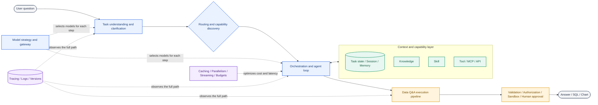
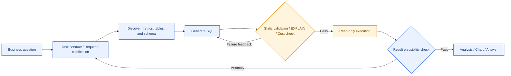
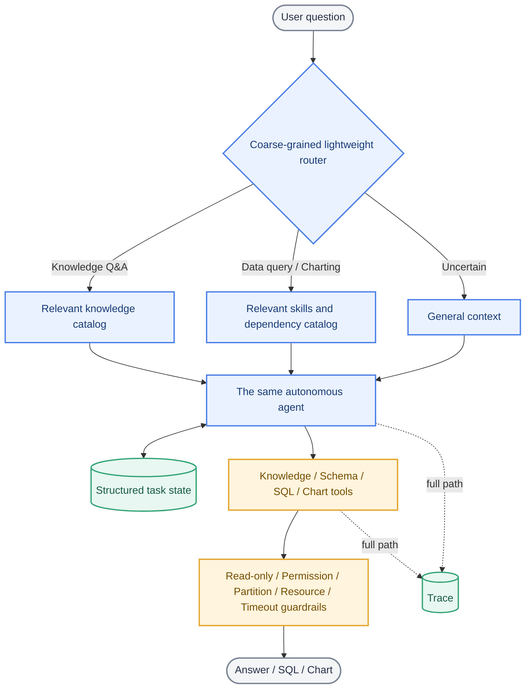

# AI Research Report (Part II): Enterprise Data Q&A Architecture Landscape

Research date: October 19, 2026

> This report first surveys the main architecture directions across the industry, then provides recommendations tailored to the company’s current situation. The survey does not omit approaches merely because they are unsuitable for immediate adoption. It focuses on architecture; knowledge-base design is covered in Part I, while evaluation metrics will be covered in Part III.

## 1. The Complete Architecture at a Glance

Enterprise Q&A AI is more than “a model plus a knowledge base.” A relatively complete system usually contains ten capability areas:



Accuracy, cost, and response speed are rarely solved by a single component. Routing reduces irrelevant context; state prevents forgetting; tools move deterministic actions into code; SQL guardrails reduce execution errors; model routing and caching control cost; and observability identifies which part of the system actually failed.

---

## 2. Major End-to-End System Shapes

These patterns describe how the complete Q&A system operates. Enterprises usually combine them by task rather than choosing only one.

| Shape | Core approach | Advantages | Main limitations | Representative evidence |
|---|---|---|---|---|
| Direct model call | One prompt produces one response, optionally with structured output | Fastest, cheapest, and easiest to maintain | Cannot independently retrieve information or take actions | OpenAI distinguishes direct Responses API usage from a complete agent runtime. [OpenAI documentation](https://developers.openai.com/api/docs/guides/agents) |
| Fixed RAG / fixed pipeline | Query rewrite → retrieval → context assembly → generation | Stable, predictable latency, easy to diagnose | Less adaptive for multi-source or multi-hop questions | [Microsoft: standard RAG versus agentic RAG](https://learn.microsoft.com/en-us/azure/architecture/ai-ml/guide/rag/rag-agentic) |
| Single agent + tools | One model autonomously selects tools, observes results, and continues in a ReAct loop | Flexible for long-tail tasks; little context handoff | Can wander, forget, or loop; cost and latency vary | Anthropic recommends starting with simple, composable agent designs. [Building Effective Agents](https://www.anthropic.com/engineering/building-effective-agents) |
| Code-defined workflow | Steps, branches, and termination conditions are predefined in code or a graph | Predictable, auditable, strong for stable tasks | A flawed process constrains the model; higher maintenance cost | Microsoft covers Sequential, Concurrent, Handoff, Group Chat, and Magentic orchestration. [Official documentation](https://learn.microsoft.com/agent-framework/workflows/orchestrations/) |
| Hybrid / bounded autonomy | The outer stages and safety boundaries are fixed, while agents decide within each stage | Balances flexibility and stability | Requires a clear boundary between model and code decisions | Anthropic distinguishes predefined workflows from dynamic agents and recommends adding complexity incrementally. [Official article](https://www.anthropic.com/engineering/building-effective-agents) |
| Multi-agent system | A router, supervisor, or orchestrator delegates subtasks to specialist agents | Isolates specialist context and permissions; supports parallelism | Usually has the highest coordination, call, and debugging overhead | OpenAI distinguishes handoffs from “agents as tools”; Google’s data-science reference architecture uses database and analytics specialists. [OpenAI](https://developers.openai.com/api/docs/guides/agents/orchestration) · [Google](https://docs.cloud.google.com/architecture/agentic-ai-data-science) |

A recurring industry conclusion is that task complexity—not the presence of multiple agents—should justify architecture complexity. OpenAI recommends adding specialists only when capability, policy, or context genuinely needs isolation; premature splitting creates more prompts, traces, and approval surfaces. [OpenAI documentation](https://developers.openai.com/api/docs/guides/agents/orchestration)

---

## 3. Ten Architecture Areas to Consider

### 3.1 Task Understanding, Clarification, and Task Contracts

| Method | Description | Advantages | Limitations |
|---|---|---|---|
| Rely only on chat history | The model extracts goals and constraints from the raw conversation | No additional implementation; most flexible | Long conversations dilute conditions, goals, and completed actions |
| Query rewriting | Convert follow-ups such as “What about Shanghai?” into standalone questions | Improves retrieval and routing stability | The rewrite can inherit context incorrectly |
| Active clarification | Ask for missing time range, scope, metric, or other critical conditions | Avoids execution based on hidden assumptions | Adds a round trip; excessive questions hurt the experience |
| Structured task contract | Store goal, metric, dimensions, filters, and deliverable in JSON/YAML state | Makes constraints explicit, testable, and reusable downstream | Requires a schema and update rules |

Microsoft’s conversational RAG guidance recommends retaining recent turns, summarizing older turns, and rewriting the current question into a self-contained query before retrieval. [Microsoft documentation](https://learn.microsoft.com/en-us/azure/architecture/ai-ml/guide/rag/rag-prompt-engineering)

### 3.2 Routing and Specialization

| Method | How it routes | Advantages | Limitations and risks |
|---|---|---|---|
| Explicit entry point | The user chooses “knowledge Q&A,” “data query,” or “charting” | Accurate and incurs no model cost | Users must understand the system taxonomy |
| Rule-based routing | Keywords, file types, commands, or regular expressions | Fast, cheap, and explainable | Weak coverage of natural-language long-tail requests |
| Small-model classifier | A separate model returns a task label and confidence | Handles ambiguous wording at relatively low cost | Adds a call; classification errors cascade |
| Main-model routing | The primary agent selects a skill, tool, or subagent from descriptions | Flexible and avoids a separate routing layer | Too many or overlapping descriptions cause misselection |
| Semantic capability discovery | Search a tool/skill catalog, then load definitions dynamically | Scales to larger catalogs and reduces standing tokens | The discovery layer can still miss the right capability |
| Handoff | Transfer conversation ownership to a specialist agent | The specialist can have separate prompts, models, and permissions | Context transfer and final responsibility become more complex |
| Agent as tool | The manager calls a specialist but retains response ownership | Consistent synthesis and clear boundaries | The manager remains a bottleneck |

Anthropic presents routing as a common workflow; OpenAI distinguishes handoffs from agents-as-tools; Microsoft notes that one retrieval tool reduces routing burden for homogeneous sources, while heterogeneous sources can justify multiple tools. [Anthropic](https://www.anthropic.com/engineering/building-effective-agents) · [OpenAI](https://developers.openai.com/api/docs/guides/agents/orchestration) · [Microsoft](https://learn.microsoft.com/en-us/azure/architecture/ai-ml/guide/rag/rag-agentic)

### 3.3 Orchestration: Who Decides the Steps?

| Pattern | Typical use | Advantages | Limitations |
|---|---|---|---|
| Prompt chaining / Sequential | A later step depends on an earlier one, such as requirements → SQL → explanation | Clear and easy to gate | Fixed steps; serial latency |
| Parallel / Fan-out | Search independent sources or analyze dimensions concurrently | Reduces latency; enables voting across attempts | Higher resource use and conflict aggregation |
| Conditional routing | Select branches by task, risk, or complexity | Each task family can be optimized independently | Routing mistakes send work down the wrong path |
| ReAct loop | The model reasons, calls a tool, observes the result, and decides again | Suitable when the path is unknown in advance | Unpredictable calls and possible loops |
| Evaluator–optimizer | A generator produces output and an evaluator supplies iterative feedback | Can improve quality when criteria are clear | At least one extra model call; the evaluator can also be wrong |
| Orchestrator–workers | Dynamically decompose work among workers, then synthesize | Good for research and unknown subtasks | Higher orchestration, deduplication, and merging cost |
| Handoff / Group chat | Agents take turns or collaborate | Clear specialist responsibilities across domains | Hardest to control cost, termination, and ownership |

Anthropic describes chaining, routing, parallelization, orchestrator-workers, and evaluator-optimizer; Microsoft additionally covers handoff, group chat, Magentic, and human-in-the-loop orchestration. [Anthropic](https://www.anthropic.com/engineering/building-effective-agents) · [Microsoft](https://learn.microsoft.com/agent-framework/workflows/orchestrations/)

### 3.4 Knowledge, Skills, Tools, and Protocols

The four concepts solve different problems:

| Object | Question answered | Typical contents | Executes actions? |
|---|---|---|---|
| Knowledge | “What are the facts?” | Metric definitions, tables, fields, tracking events, and business background | No |
| Skill | “How is this type of task usually completed?” | Method, dependencies, checkpoints, examples, and exception handling | Usually guides the agent to call tools rather than acting itself |
| Tool | “Which deterministic action should be executed?” | Inspect schema, validate SQL, run a query, create a chart | Yes |
| Protocol / gateway | “How do clients consistently discover and call capabilities?” | MCP, OpenAPI, A2A, unified authentication, and auditing | Connects and governs; does not supply business reasoning |

“Break down revenue by device model” is better represented as a skill, while revenue definitions, device definitions, and table documentation remain independent knowledge objects. The skill declares dependencies and loads them on demand:

```yaml
id: skill.revenue_by_device
summary: Break down revenue by device model and produce a table or chart
dependencies:
  required: [metric.revenue, dimension.device_model]
  conditional: [dataset.revenue_tables, knowledge.device_model_refresh]
allowed_tools: [search_knowledge, get_schema, validate_sql, run_readonly_sql, create_chart]
```

Common tool-design approaches include:

| Design | Advantages | Limitations | Industry evidence |
|---|---|---|---|
| Function calling + strict schema | Validatable parameters; good fit for internal APIs | Large tool catalogs consume context and complicate selection | OpenAI distinguishes functions, MCP, tool search, and programmatic tool calling. [Official documentation](https://developers.openai.com/api/docs/guides/tools) |
| Coarse-grained tool | Completes a full business action in one call | Large black box, hard to reuse, broad permission surface | Suitable for stable, deterministic business transactions |
| Fine-grained tool | Composable, observable, and easier to grant narrowly scoped permissions | Requires more calls and can encourage agent detours | Suitable for schema lookup and SQL validation |
| Deferred loading / tool search | Loads only the tool definitions needed now and saves tokens | Discovery failure can hide a required capability | OpenAI Tool Search and Anthropic `defer_loading` both support just-in-time loading. [OpenAI](https://developers.openai.com/api/docs/guides/tools) · [Anthropic](https://platform.claude.com/docs/en/agents-and-tools/tool-use/tool-use-with-prompt-caching) |
| MCP: standardized discovery and invocation of Tools, Resources, and Prompts | Reusable across clients; clear service boundary | Does not replace permission, security, or business-semantic design | [Official MCP architecture](https://modelcontextprotocol.io/docs/learn/architecture) |
| A2A / Agent API: call a relatively autonomous external agent | Useful across teams or organizations | More opaque than a tool; coordination and auditing are harder | Microsoft recommends MCP for tools/data and A2A for independent agent collaboration. [Official guidance](https://learn.microsoft.com/en-us/microsoft-copilot-studio/guidance/architecture/multi-agent-patterns) |

### 3.5 Context, Task State, and Memory

| Layer | What it stores | Lifetime | Main value |
|---|---|---|---|
| Current prompt | Instructions and material required for the current model call | One model call | Controls current behavior |
| Conversation / session | Recent messages and tool results | One session | Supports multi-turn references and continuity |
| Task state / scratchpad | Goal, confirmed constraints, SQL history, result references, and next action | One task | Prevents forgetting, duplicate execution, and version regression |
| Checkpoint / durable state | Per-step state, pause points, and retry information | Across processes and failures | Restores long tasks and supports human approval |
| Long-term memory | User preferences, historical experience, and cross-session facts | Long term | Personalization and experience reuse |
| Knowledge base | Stable facts shared across the company | Independently governed | Must not be mixed with temporary state from one task |

Common context-control methods include sliding windows, conversation summaries, tool-result clearing, structured notes, on-demand retrieval, and compaction. Anthropic treats context as a finite resource and recommends compaction, structured note-taking, and just-in-time loading; Google ADK explicitly separates Session, State, and cross-session Memory. [Anthropic](https://www.anthropic.com/engineering/effective-context-engineering-for-ai-agents) · [Google ADK](https://google.github.io/adk-docs/sessions/)

For data Q&A, even a minimal task-state object can materially improve reliability:

```yaml
goal: Break down revenue by device model and produce a trend chart
confirmed_constraints:
  metric: platform_revenue
  date_range: 2026-10-01..2026-10-18
  dimensions: [device_model]
sql_history:
  - {id: q1, purpose: Check device-model coverage, status: succeeded, result_ref: result/q1}
  - {id: q2, purpose: Aggregate revenue, status: failed, error: missing_partition_filter}
next_action: Add the date partition filter to q2
```

### 3.6 Data Q&A and the Text-to-SQL Execution Pipeline

Unlike ordinary knowledge Q&A, data Q&A must select data assets, generate code, execute it, and validate the result. Major industry shapes include:

| Shape | Approach | Advantages | Limitations |
|---|---|---|---|
| Direct Text-to-SQL | Generate SQL once from the question and schema | Simple and fast | Unreliable for complex metrics, table selection, and ambiguity |
| Retrieval-augmented Text-to-SQL | Retrieve relevant tables, fields, definitions, and historical SQL before generation | Reduces schema noise and reuses golden SQL | Depends heavily on knowledge quality; stale SQL propagates errors |
| Semantic-layer-driven | Structure metrics, dimensions, joins, and permissions before the model generates a semantic query or constrained SQL | Consistent and governable business definitions | High upfront modeling cost; long-tail fields still need handling |
| Agentic Text-to-SQL | An agent inspects catalogs/schema, generates SQL, test-runs it, reads errors, and repairs it | Suitable for complex and exploratory needs | Slower and more expensive; loops and permissions need strict limits |
| Multi-agent data science | Database, analytics, and visualization agents specialize | Isolates context and permissions; complex analysis can run in parallel | More handoff and operational complexity |
| Code-as-action / sandbox | The model writes Python or SQL and iterates in an isolated environment | Flexible for exploratory analysis | Requires code security, resource limits, and lifecycle management |

A relatively complete pipeline can retain agent autonomy while enforcing deterministic boundaries:



This does not require every step to become a fixed workflow. The agent can still decide when to search knowledge and when to clarify, while code guarantees read-only SQL, valid tables and fields, partition filters, permissions, scan limits, timeouts, and result references. Google’s data-science agent architecture separates coordination, database querying, analytics, and visualization; Google’s code-execution tool provides a task-persistent sandbox with process isolation and retained intermediate state. [Google data-science architecture](https://docs.cloud.google.com/architecture/agentic-ai-data-science) · [Google ADK sandbox](https://google.github.io/adk-docs/tools/google-cloud/code-exec-agent-engine/)

### 3.7 Model Strategy and Model Gateways

| Strategy | Advantages | Limitations | Suitable situations |
|---|---|---|---|
| One strong model | Consistent behavior and simple maintenance | Every step pays the highest price and latency | Early validation and smaller workloads |
| Task-based routing | Use small models for classification/extraction and stronger models for complex planning | Must maintain routing logic and model-specific behavior | Clear task categories and substantial traffic |
| Cascade / escalation | Start with a cheaper model and escalate on low confidence or failure | Lower average cost | Bad escalation decisions hurt accuracy; worst-case latency increases |
| Fallback | Switch providers or models on failure or throttling | Improves availability | Tool-call behavior and output formats can differ |
| Ensemble / voting | Generate or verify with several models and aggregate | Can improve some high-risk tasks | Multiplies cost and latency; the majority is not guaranteed correct |
| Model gateway | Centralize authentication, quotas, routing, retries, and cost accounting | Reduces provider lock-in and centralizes governance | Becomes critical infrastructure and a security boundary |

Microsoft recommends assigning classification, extraction, formatting, and routing to smaller, faster models while reserving stronger models for ambiguous reasoning and synthesis. [Microsoft Agent Host](https://learn.microsoft.com/en-us/agents/architecture/host-platform) In open source, [LiteLLM](https://github.com/BerriAI/litellm) is a representative multi-model gateway project (approximately 61.5k stars at the research snapshot).

### 3.8 Cost and Latency Engineering

| Technique | Cost impact | Latency impact | Accuracy risk |
|---|---:|---:|---|
| Context reduction / progressive loading | ↓ | ↓ | Insufficient recall can omit information |
| Prompt-prefix caching | ↓ | ↓ | Usually output-neutral; requires a stable prefix |
| Deferred tool/skill loading | ↓ | ↓ or slightly ↑ | Discovery failure can hide a capability |
| Parallel tool calls | Roughly unchanged or slightly ↑ | ↓ | Only for independent work; aggregation may expose conflicts |
| Result caching | Substantially ↓ | Substantially ↓ | Stale data or incomplete cache keys |
| Streaming | Roughly unchanged | Lower time-to-first-token | Total completion time may not decrease |
| Turn / token / time budgets | ↓ | ↓ | An undersized budget truncates complex tasks |
| Deterministic code instead of LLM inference | ↓ | ↓ and more stable | Only appropriate for well-defined rules |
| Background / asynchronous jobs | Roughly unchanged | Removes synchronous waiting | Adds task-state and notification complexity |

Anthropic documents caching for stable tool definitions, system instructions, and history prefixes; deferred tools can preserve that cached prefix. Microsoft likewise highlights parallel calls, context trimming, caching, and turn budgets as primary cost and latency levers. [Anthropic](https://platform.claude.com/docs/en/agents-and-tools/tool-use/tool-use-with-prompt-caching) · [Microsoft](https://learn.microsoft.com/en-us/agents/architecture/host-platform)

### 3.9 Reliability, Security, and Governance

| Control point | Typical mechanism | Problem addressed |
|---|---|---|
| Input/output schemas | Types, enums, required fields, lengths, and format checks | Hallucinated tool parameters and downstream parsing failures |
| Least privilege | Separate identities per tool; expose only required tables and actions | Unauthorized access and accidental operations |
| SQL/code static checks | AST inspection, read-only allowlists, and forbidden statements | Writes, injection, and unsafe code |
| Runtime isolation | Sandboxes, network allowlists, CPU/memory/time limits | Limits generated-code risk |
| Budgets and stop conditions | Tool-call, token, time, and retry limits | Infinite loops and runaway cost |
| Retry / timeout / circuit breaker | Bounded retries, backoff, circuit breaking, and degradation | External-service instability |
| Idempotency / checkpoint | Request IDs, result references, and persisted steps | Duplicate execution and recovery after failure |
| Human-in-the-loop | Approval for high-risk actions; escalation on low confidence | Long-tail risk that cannot be safely automated |
| Provenance and audit | Answer citations and versioned SQL, parameters, results, and operators | Traceability and incident review |

Microsoft treats every tool as an attack surface and recommends parameter validation, input sanitization, and least-privilege access. The OpenAI Agents SDK treats guardrails and human review as separate capabilities, while Google’s code execution uses process-level isolation. [Microsoft](https://learn.microsoft.com/en-us/azure/architecture/ai-ml/guide/rag/rag-agentic) · [OpenAI](https://developers.openai.com/api/docs/guides/agents/sdk) · [Google](https://google.github.io/adk-docs/tools/google-cloud/code-exec-agent-engine/)

### 3.10 Observability, Runtime, and Deployment

| Direction | Capabilities or data to provide | Value |
|---|---|---|
| End-to-end tracing | Prompt/model version, route, retrieval, tool parameters/results, latency, tokens, and errors | Determines whether failure came from knowledge, routing, SQL, or the model |
| Prompt / skill / tool versioning | Reconstruct the exact versions used in every run | Regression analysis, staged rollout, and rollback |
| Replay | Rerun historical traces against a new version | Detects behavior changes at low cost |
| Durable execution | Checkpoints, pause/resume, and bounded retries | Long-running work and failure recovery |
| Synchronous/asynchronous split | Fast Q&A stays synchronous; large queries and complex charts run asynchronously | Controls perceived waiting time |
| Managed runtime | Vendor-managed sessions, sandboxes, tracing, and scaling | Faster launch with less customization and portability |
| Self-hosted runtime | Operate agent services, queues, state stores, gateways, and sandboxes | Greater data control at higher operational cost |

OpenAI tracing records model calls, tools, handoffs, and guardrails. LangGraph emphasizes checkpoints, durable execution, and human-in-the-loop. Langfuse and Phoenix are popular open-source observability options. [OpenAI](https://developers.openai.com/api/docs/guides/agents/integrations-observability) · [LangGraph](https://github.com/langchain-ai/langgraph) · [Langfuse](https://github.com/langfuse/langfuse) · [Phoenix](https://github.com/Arize-ai/phoenix)

---

## 4. Map of Major Vendors and High-Star Open-Source Projects

This is not a product ranking. It shows which problems each organization or project emphasizes.

| Organization / project | Representative focus | What to learn from it | Evidence type |
|---|---|---|---|
| Anthropic | Simple composable patterns, agent/workflow boundary, context engineering, skills, deferred tool loading, and caching | Add complexity progressively; treat context as scarce; load skills on demand | [Official engineering article](https://www.anthropic.com/engineering/building-effective-agents) · [Official context article](https://www.anthropic.com/engineering/effective-context-engineering-for-ai-agents) |
| OpenAI | Responses, Agents SDK, tools, handoffs, agents-as-tools, guardrails, tracing, and sandboxes | Clear path from single-agent to multi-agent systems; explicit boundaries between tools and specialists | [Official OpenAI documentation](https://developers.openai.com/api/docs/guides/agents/sdk) |
| Google Cloud / ADK | Root agent plus database/analytics specialists; Session/State/Memory; persistent sandbox | Data-analysis specialization, task-level execution environments, and state scopes | [Data-science architecture](https://docs.cloud.google.com/architecture/agentic-ai-data-science) · [ADK sessions](https://google.github.io/adk-docs/sessions/) |
| Microsoft | Standard and agentic RAG, workflow patterns, host cost model, MCP/A2A | Criteria for moving from fixed retrieval to agentic retrieval; multi-agent and protocol governance | [Agentic RAG](https://learn.microsoft.com/en-us/azure/architecture/ai-ml/guide/rag/rag-agentic) · [Orchestration](https://learn.microsoft.com/agent-framework/workflows/orchestrations/) |
| Alibaba / Spring AI Alibaba | ReActAgent, graph runtime, sequential/parallel/routing/loop patterns, multi-agent, skills, MCP, A2A, and sandboxing | Integrated agent/workflow stack for Java; context-engineering hooks | [GitHub, approximately 11k stars](https://github.com/alibaba/spring-ai-alibaba) |
| Alibaba / Qwen-Agent | Function calling, MCP, RAG, code interpreter, and parallel/multi-turn tool calls | Relatively lightweight Python agent capabilities in the Qwen ecosystem | [GitHub, approximately 17.1k stars](https://github.com/QwenLM/Qwen-Agent) |
| ByteDance / Eino | Go component abstractions, graph/chain, ADK, tools, checkpoints, middleware, and multi-agent | Strongly typed composition and production engineering for Go services | [GitHub, approximately 13.3k stars](https://github.com/cloudwego/eino) |
| Tencent Cloud / Youtu-Agent | Workflow and Meta-Agent modes, automatic agent/tool generation, context manager, tracing, and evaluation | Autonomous agents and automatic capability generation using open models; oriented toward research and complex agents | [GitHub, approximately 4.6k stars](https://github.com/TencentCloudADP/youtu-agent) |
| LangGraph | State graphs, checkpoints, durable execution, memory, and human-in-the-loop | Recoverable long-running state without tight coupling to one model | [GitHub, approximately 43.2k stars](https://github.com/langchain-ai/langgraph) |
| Microsoft AutoGen | Conversational multi-agent, asynchronous messaging, group chat, and Magentic-One | Representative multi-agent research and conversational coordination; new projects should track its evolution into Microsoft Agent Framework | [GitHub, approximately 61.4k stars](https://github.com/microsoft/autogen) · [Official evolution notice](https://github.com/microsoft/autogen/discussions/7066) |
| MCP | Unified discovery and invocation of Tools, Resources, and Prompts | Decouples agents from databases, knowledge, and internal services; does not replace permission design | [Official MCP architecture](https://modelcontextprotocol.io/docs/learn/architecture) |
| LiteLLM | Unified multi-model API, routing, budgets, fallback, and gateway governance | Provider abstraction and centralized cost governance | [GitHub, approximately 61.5k stars](https://github.com/BerriAI/litellm) |
| Langfuse | Tracing, prompt management, cost/latency, datasets, and experiments | Self-hosted observability and debugging for LLM and agent systems | [GitHub, approximately 36k stars](https://github.com/langfuse/langfuse) |
| Arize Phoenix | OpenTelemetry/OpenInference, tracing, experiments, and replay | Agent observability built around open standards | [GitHub, approximately 11.4k stars](https://github.com/Arize-ai/phoenix) |
| Vanna | Text-to-SQL using retrieved schema, documents, and historical SQL | Illustrates the golden-SQL plus schema-retrieval approach; the repository was archived in March 2026 and is not recommended as a new system foundation | [GitHub, approximately 23.8k stars](https://github.com/vanna-ai/vanna) |

> GitHub stars are a snapshot from October 19, 2026. They indicate community attention, not enterprise fit, code quality, or a guarantee of continued maintenance.

---

## 5. Three Central Trade-offs

### 5.1 Is More Autonomy Always Better?

No. Autonomy suits tasks whose path is unknown and exploratory. Deterministic workflows suit stable, high-risk, and auditable tasks. A common production compromise is: **the model decides how to search and analyze; code guarantees what it cannot do, that state is not lost, and that execution can recover.**

### 5.2 Do More Tools Always Mean More Capability?

The system may gain capabilities, but the model’s selection problem becomes harder. Typical remedies include exposing only route-relevant tools, discovering before loading, merging highly similar tools, and documenting both when each tool should and should not be used. Microsoft’s agentic RAG guidance likewise recommends one retrieval tool for a homogeneous source, multiple tools for heterogeneous sources, and a bounded visible tool set. [Official documentation](https://learn.microsoft.com/en-us/azure/architecture/ai-ml/guide/rag/rag-agentic)

### 5.3 Is Multi-agent the Upgrade Path from Single-agent?

Not linearly. Multi-agent architecture is valuable when it isolates context, responsibility, permission, or parallel work. Its cost is additional model calls, information handoffs, and debugging surfaces. If several steps share one goal and context, a single agent with tools or a hybrid workflow is often simpler.

---

## 6. Recommendations for the Company’s Current Stage

Only this section is prescriptive; it does not imply that the industry landscape is limited to these options.

### Appropriate to Advance Now



1. **Keep one autonomous agent:** Do not split into multiple agents or immediately force all data requests into a complete Step 1–N process.
2. **Add coarse-grained routing:** Routing should only change which knowledge, skills, and tools are prioritized. Low-confidence cases should fall back to general mode rather than refusing the task.
3. **Build task state first:** Persist the final goal, confirmed constraints, selected knowledge/tables, SQL versions and execution results, and the next action. This directly addresses the current problems of forgetting conditions, SQL, and the final objective.
4. **Convert long, high-frequency runbooks into skills plus dependencies:** For example, “break down revenue by device model” becomes a skill, while revenue definitions, device-model definitions, and table logic remain reusable knowledge. Initially keep the steps advisory rather than mandatory.
5. **Implement database boundaries in code:** Do not rely on model memory for read-only enforcement, permissions, table/field checks, date partitions, scan limits, timeouts, or result references.
6. **Retain traces from day one:** At minimum, record routing, loaded knowledge, skill, tool calls, SQL versions, result references, latency, tokens, and errors. Otherwise it will be impossible to know which intervention actually helped.
7. **Start with low-risk performance optimizations:** Load context on demand, cache stable prompts and tool definitions, read independent documentation/schema in parallel, and set tool/time budgets.

### Advance After Operational Evidence Accumulates

- Introduce model tiers or cascades based on the actual task distribution and failure modes observed in traces.
- Convert only empirically stable local steps into fixed workflows.
- After tables and metrics become more structured, introduce a semantic layer, schema linking, or retrieval-augmented Text-to-SQL.
- Add checkpointing or durable-execution frameworks once tasks often run for minutes or require pause/resume and human intervention.
- Add tool search, an MCP registry, or a unified tool gateway once the tool catalog grows materially.

### Keep as Future Options, Not Default Architecture

- Immediately split knowledge Q&A, SQL, and charting into separate agents.
- Send every question through agentic RAG, multi-round self-reflection, or multi-model voting.
- Build a complex graph state machine before the process has been validated.
- Let the model control permissions, SQL safety, or cost boundaries merely to make the system “more agentic.”

These approaches are not inherently poor; their current benefits do not yet justify their complexity. Reassess them when clear needs emerge for context isolation, permission isolation, parallel execution, or cross-team agent collaboration.

---

## 7. Suggested Evolution Sequence

| Stage | Core change | Main improvement | Autonomy retained |
|---|---|---|---|
| A. Observability baseline | Tracing plus prompt/skill/tool versioning | Reveals where failures actually occur | Fully retained |
| B. Task state | Persist goal, constraints, SQL, results, and next action | Reduces forgetting, duplicate execution, and version regression | Fully retained |
| C. Lightweight routing | Filter only context, skills, and tools | Improves relevance and reduces tokens and selection interference | Fully retained with fallback |
| D. Skill pilot | Convert long runbooks into skills plus knowledge dependencies | Enables progressive reading and avoids losing the model in long documents | Steps remain advisory |
| E. Basic SQL guardrails | Read-only, permissions, partitions, cost, and timeouts | Improves safety and execution reliability | Free reasoning within hard execution boundaries |
| F. Local workflows | Fix only steps proven stable by real cases | Improves consistency for repeatable scenarios | Tightened only locally |
| G. Model/runtime optimization | Model routing, caching, parallelism, and checkpoints | Controls cost and latency at scale | Adjusted by task |
| H. Multi-agent / agentic RAG | Introduce only when isolation or complex multi-hop value is clear | Expands capability for complex work | Highest autonomy and highest governance complexity |

## 8. References

### Official Vendor Sources

1. Anthropic, [Building Effective Agents](https://www.anthropic.com/engineering/building-effective-agents)
2. Anthropic, [Effective Context Engineering for AI Agents](https://www.anthropic.com/engineering/effective-context-engineering-for-ai-agents)
3. Anthropic, [Agent Skills](https://platform.claude.com/docs/en/agents-and-tools/agent-skills/overview)
4. Anthropic, [Tool Use with Prompt Caching](https://platform.claude.com/docs/en/agents-and-tools/tool-use/tool-use-with-prompt-caching)
5. OpenAI Docs, [Agents SDK](https://developers.openai.com/api/docs/guides/agents/sdk)
6. OpenAI Docs, [Using Tools](https://developers.openai.com/api/docs/guides/tools)
7. OpenAI Docs, [Orchestration and Handoffs](https://developers.openai.com/api/docs/guides/agents/orchestration)
8. OpenAI Docs, [Integrations and Observability](https://developers.openai.com/api/docs/guides/agents/integrations-observability)
9. Google Cloud, [Automate Data Science Workflows with Agents](https://docs.cloud.google.com/architecture/agentic-ai-data-science)
10. Google ADK, [Sessions, State, and Memory](https://google.github.io/adk-docs/sessions/)
11. Google ADK, [Agent Runtime Code Execution](https://google.github.io/adk-docs/tools/google-cloud/code-exec-agent-engine/)
12. Microsoft, [Develop an Agentic RAG Solution](https://learn.microsoft.com/en-us/azure/architecture/ai-ml/guide/rag/rag-agentic)
13. Microsoft, [AI Agent Orchestration Patterns](https://learn.microsoft.com/en-us/azure/architecture/ai-ml/guide/ai-agent-design-patterns)
14. Microsoft, [Agent Framework Orchestrations](https://learn.microsoft.com/agent-framework/workflows/orchestrations/)
15. Microsoft, [Choice of Agent Host](https://learn.microsoft.com/en-us/agents/architecture/host-platform)
16. Microsoft, [Multi-agent Architecture with MCP and A2A](https://learn.microsoft.com/en-us/microsoft-copilot-studio/guidance/architecture/multi-agent-patterns)
17. MCP, [Official Architecture](https://modelcontextprotocol.io/docs/learn/architecture)

### Open-Source Projects

18. [Spring AI Alibaba](https://github.com/alibaba/spring-ai-alibaba)
19. [Qwen-Agent](https://github.com/QwenLM/Qwen-Agent)
20. [ByteDance CloudWeGo Eino](https://github.com/cloudwego/eino)
21. [Tencent Cloud Youtu-Agent](https://github.com/TencentCloudADP/youtu-agent)
22. [LangGraph](https://github.com/langchain-ai/langgraph)
23. [Microsoft AutoGen](https://github.com/microsoft/autogen)
24. [LiteLLM](https://github.com/BerriAI/litellm)
25. [Langfuse](https://github.com/langfuse/langfuse)
26. [Arize Phoenix](https://github.com/Arize-ai/phoenix)
27. [Vanna](https://github.com/vanna-ai/vanna)

> Note: Industry methods and project capabilities are drawn from the linked official pages or project repositories. The company-specific recommendations and evolution sequence are this report’s judgments based on the current Markdown Wiki, Claude Code retrieval approach, autonomous data-query workflow, and known failure modes; they are not official recommendations from any vendor.
